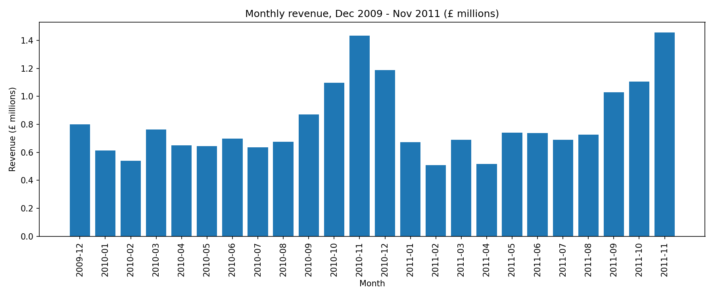

# Online Retail Sales Analysis

Analysis of two years of transactions from a UK-based online gift-ware retailer (Dec 2009 - Dec 2011), covering revenue trends, products, countries and customers. Built with Python (pandas, matplotlib) in Google Colab.

## Questions answered
1. Which months bring in the most revenue?
2. Which products and countries drive sales?
3. Who are the top customers, and how loyal are customers?
4. How much revenue is lost to returns and cancellations?

## Key findings
- **Net revenue was about £19.4M** over the two years, after removing non-product rows and subtracting returns.
- **Revenue peaks in November** and rises from September in both 2010 and 2011, a clear Christmas season. February is the weakest month.
- **The UK accounts for about 86% of revenue.** The largest export markets are Ireland, the Netherlands and Germany.
- **Top product by net revenue:** Regency Cakestand 3 Tier (about £328K), followed by White Hanging Heart T-Light Holder (about £258K).
- **Returns are about 3% of sales.**
- **72% of customers (4,234 of 5,852) ordered more than once.** The top 10 customers account for about 16% of customer revenue.

## Data cleaning decisions
The raw data has 1,067,371 rows. I split it into three groups instead of deleting rows blindly:
- **Sales:** normal invoices with a positive price.
- **Returns:** invoices starting with "C" (cancelled orders), kept in a separate table and subtracted when calculating net revenue.
- **Adjustments:** rows with a price of 0 or less and no customer (lost or damaged stock, manual stock fixes), set aside.

Within sales, I also removed rows that are not products: postage, fees, manual entries, bank charges, test items, gift vouchers and near-zero-price rows.

Other decisions:
- **About 23% of rows have no Customer ID.** They are real sales, so I kept them for revenue, product and country questions, and excluded them only from customer questions.
- **One order of 80,995 units was cancelled in full** the next invoice. It nets to £0, so I counted it as zero when ranking products.
- **December 2011 is incomplete** (data ends on 9 December), so I left it out of the monthly chart.

## Tools
Python, pandas, matplotlib, Google Colab

## Data source
Chen, D. (2012). *Online Retail II* [Dataset]. UCI Machine Learning Repository. https://doi.org/10.24432/C5CG6D. Licensed CC BY 4.0. The data file is not included here because of its size; download it from the UCI page.

## Notebook
See `online_retail_analysis.ipynb`.
